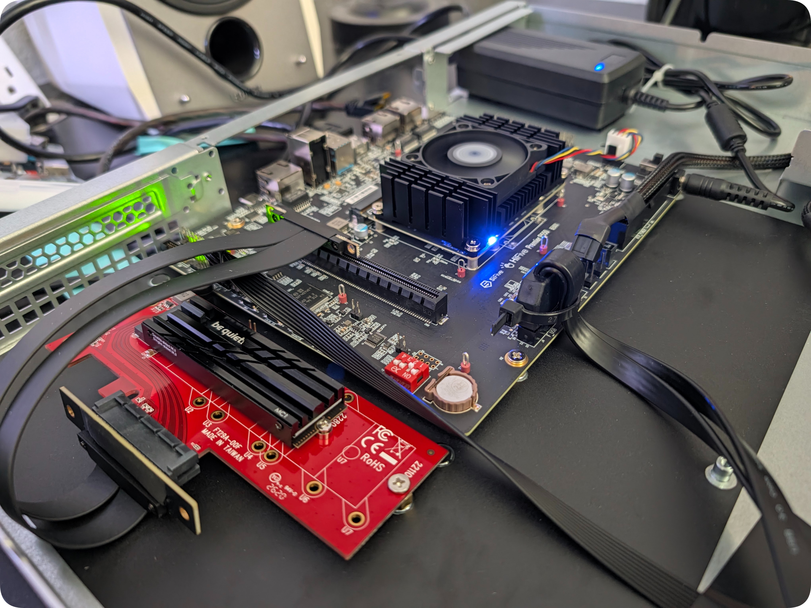

<div align="center">

# BrakerBox-P550 

*SiFive HiFive Premier P550 Data Broker*

  

</div>

**Rack Location:** `BrackerRack U10; target=U04`   
**Primary Role:** Interim Production Data Broker (`brakerbox-p550`) & 3-Wide Out-of-Order RVA20 Benchmark Target (`brakerbench-p550`)  
**Ecosystem:** `DREW-V Labs` // `BrakerRack` & `HamStack` (`CarrierPigeons` Wrapper)

---

## 1. Architectural Overview

`brakerbox-p550` is a 1U rackmount RISC-V data broker built around the **SiFive HiFive Premier P550** (`HF106-001`) Mini-DTX platform. Within the `BrakerRack` matrix, it serves two functions:

1. **Interim Production Data Broker (`--role prod`):** Hosts **PostgreSQL 18** (`PigeonCoop` Continuous Telemetric Documentation ledger), MQTT ingestion, and tiered storage pools while `brakerbox-titan` is on backorder.
2. **Microarchitectural Benchmark Target (`--role bench`):** Provides a **13-stage, triple-issue, Out-of-Order (OoO)** `RVA20` (`RV64GC` + `Zba`/`Zbb`) reference pipeline with 4MB of coherent L3 cache to benchmark against the 8-stage, dual-issue **In-Order** `SiFive U74` (`brakerbench-vf2`) and 4-wide OoO architectures.

---

## 2. Hardware & 1U Mechanical Packaging

| Subsystem | Specification | Notes |
| :--- | :--- | :--- |
| **Board / SoC** | SiFive HiFive Premier P550 (`ESWIN EIC7700X`) | Mini-DTX (`203mm × 170mm`), STM32 Out-of-Band BMC |
| **CPU Complex** | 4x SiFive Performance P550 Cores @ 1.4GHz | 13-stage, 3-Wide OoO, `rv64imafdc_zicsr_zifencei_zba_zbb` |
| **Cache Hierarchy** | 32KB L1I + 32KB L1D / 256KB Private L2 / 4MB Shared L3 | SECDED ECC on L3 Cache |
| **System Memory** | 32GB LPDDR5-6400 | Soldered on SOM |
| **Boot / Root OS** | 128GB Soldered eMMC (`mmcblk0`) | Ubuntu 24.04 LTS (`multi-user.target` headless strip) |
| **Tier 0 (Hot NVMe)** | 2TB `WD_BLACK SN850X` (`nvme0n1`) + `be quiet! MC1` Heatsink | PCIe Gen3 x4 (`8.0 GT/s`), formatted to native `4096B` (`4Kn`) LBA |
| **PCIe Riser Assembly** | StarTech `PEX4M2E1` + Folded Twin-Axial PCIe x4 Ribbon Riser | Anchored to chassis floor via ATX standoff + elastomer isolation bumpers |
| **Tier 1 (Warm Vault)** | `BigRed-WDR48` (`U08`) — SilverStone 4-Bay USB 3.2 Gen 1 | 4x 12TB WD Red Plus CMR (`mdadm` RAID 10, `/mnt/bigred_wdr48`) |
| **Tier 2 (Cold Archive)** | `LilBlu-WDB24` (`U09`) — SilverStone 4-Bay USB 3.2 Gen 1 | 4x 6TB WD Blue (`mdadm` RAID 10, `/mnt/lilblu_wdb24`) |
| **Chassis & Power** | SilverStone `SST-RM100` (1U) + PicoPSU / Internal 12V Brick | 40mm chassis fans disconnected; SOM active cooler idles at ~27°C (ΔT ≈ 7°C) |

### USB Root Hub Topology Note
All external USB 3.2 Gen 1 ports on the HF106 carrier board sit behind a single **Synopsys DesignWare USB 3.0 Root Hub (`5000M` / ~450 MB/s shared bandwidth)**. High-concurrency transactional workloads (`PGDATA` and WAL) are strictly pinned to the PCIe Gen3 x4 `WD_BLACK SN850X` (`nvme0n1`), while `BigRed-WDR48` and `LilBlu-WDB24` serve warm/cold tablespaces and bulk archives over the rear teal USB 3.2 Gen 1 ports.

---

## 3. Storage & PostgreSQL 18 Tuning Stack

### A. Native `4Kn` (`4096`-Byte) NVMe Alignment
Factory `WD_BLACK SN850X` drives ship in emulated `512e` (`512`-byte logical sector) mode. During Stage 1/2 of `forge.sh`, `nvme-cli` inspects the namespace capabilities (`lbads:12` -> `4096B`) and executes a low-level `nvme format` to native **`4Kn` (`4096`-byte)** sectors prior to LVM physical volume alignment (`--dataalignment 4m`) and XFS creation (`-s size=4096 -b size=4096`). This eliminates internal SSD controller Read-Modify-Write (RMW) translation penalties on PostgreSQL 8KB page flushes.

### B. LVM Snapshot Reserve
`forge.sh` allocates `85%VG` to `/dev/vg_braker/lv_pgdata` (`/mnt/nvme_pgdata`), reserving `15%VG` (~270GB) of unallocated extents. This allows instant, zero-downtime LVM copy-on-write (CoW) snapshots to reset database state between deterministic benchmark runs.

### C. PostgreSQL 18 Drop-In Configuration (`99-brakerbox-p550.conf`)
* **Async I/O Engine:** `io_method = io_uring` (auto-verified against `liburing` linkage and `kernel.io_uring_disabled = 0`)
* **Memory Allocation (32GB LPDDR5):** `shared_buffers = 8GB`, `effective_cache_size = 24GB`, `work_mem = 64MB`, `maintenance_work_mem = 2GB`, `huge_pages = try`
* **RVA20 4-Hart OoO Execution:** `jit = off` (avoids LLVM JIT compilation overhead on scalar RVA20), `max_worker_processes = 4`, `max_parallel_workers = 4`, `max_parallel_workers_per_gather = 2`
* **WAL & Checkpoints:** `wal_compression = zstd`, `wal_buffers = 64MB`, `min_wal_size = 2GB`, `max_wal_size = 16GB`, `checkpoint_completion_target = 0.9`

---

## 4. Directory Structure

```text
brakerrack/nodes/databrokers/brakerbox-p550/
├── README.md          # Node architecture, hardware topology, and convergence runbook
├── forge.sh           # Idempotent bare-metal provisioning & PostgreSQL 18 forge script
├── ort-snapshot.py    # Read-only Day-0/Day-1 ORT assertion & CTD JSON manifest generator
└── snapshots/         # Signed JSON provenance baselines (pre-forge & post-forge)
```

---

## 5. Deployment, ORT & Convergence Runbook

### Stage 0: Day-0 Pre-Forge Operational Readiness Test (ORT) & Clean-Room Snapshot
Before modifying packages or block devices on a newly imaged node, execute `ort-snapshot.py` (100% Python 3 stdlib, zero package installs) to verify L1/L2 hardware seating (`PCIe 8.0 GT/s x4`, `5000M` USB SuperSpeed, thermal floor) and generate a `SHA-256` signed Clean-Room baseline artifact:

```bash
sudo -v && ./ort-snapshot.py --stage day0-pre-forge
```

### Stage 1: Cold Convergence Forge (`forge.sh`)
Run the idempotent forge script to strip desktop/snap bloat, configure `sysctl` PMU access (`kernel.perf_event_paranoid = -1`), format `nvme0n1` to `4Kn`, assemble the `mdadm` RAID 10 arrays, and deploy PostgreSQL 18:

```bash
# Standard Interim Production Build (NVMe + PG18 + BigRed & LilBlu RAID 10)
sudo ./forge.sh --role prod --with-raid

# NVMe + PG18 Only (Skip USB RAID 10 arrays)
sudo ./forge.sh --role prod

# Benchmark Role Designation (Sets hostname to brakerbench-p550)
sudo ./forge.sh --role bench
```

### Stage 2: Idempotency Validation Pass
Immediately re-run `./forge.sh` after initial convergence. Every stage must output `[SKIP] (already configured)` with zero service restarts, zero duplicate `/etc/fstab` entries, and exit code `0`:

```bash
sudo ./forge.sh --role prod --with-raid
```

### Stage 3: Day-1 Post-Forge CTD Provenance Snapshot
Capture the converged system state (recording the package delta, active `4096B` LBA sector size, mounted XFS volumes, and live PostgreSQL `SHOW` parameters):

```bash
sudo -v && ./ort-snapshot.py --stage day1-post-forge
```


---

<div align="center">

**DREW-V LABS** // **Drew Vandagriff** — *Richardson, TX*  
`Simplicity in Architecture · Efficiency in Engineering · Purity in Science · Audacity in Art · Life in Logic`

</div>
